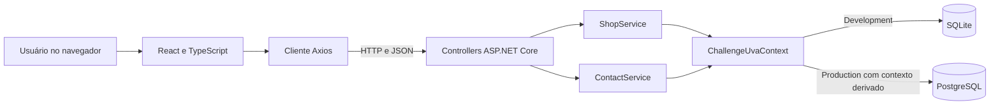
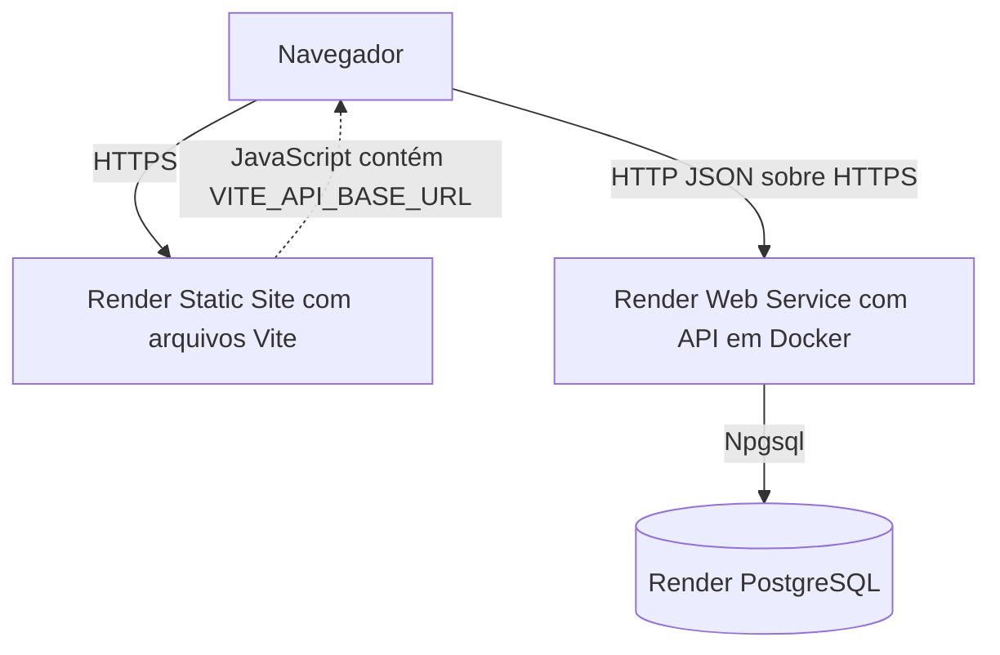

# Arquitetura e tecnologias

## Visão geral

A aplicação utiliza uma interface React que se comunica por HTTP com uma API ASP.NET Core. A API executa as regras de negócio e utiliza Entity Framework Core para persistir os dados. O banco local é SQLite, enquanto a configuração de produção seleciona PostgreSQL.

Os dois bancos representam alternativas de ambiente. A aplicação não grava simultaneamente em SQLite e PostgreSQL nem sincroniza os dados entre eles.

## Organização do repositório

| Parte | Responsabilidade |
| --- | --- |
| `frontend/src/pages/Store` | Vitrine, produtos, carrinho, checkout, recusa, pedidos e contato |
| `frontend/src/components` | Componentes visuais, máscaras, notificações e depoimentos |
| `frontend/src/app` | Rotas, composição dos providers e estado do carrinho |
| `frontend/src/services` | Contratos TypeScript, configuração Axios e chamadas HTTP |
| `ChallengeUva.Domain` | Entidades, contratos de entrada e retorno de contato |
| `ChallengeUva.Application` | Serviços da loja e de recebimento de mensagens |
| `ChallengeUva.Infrastructure` | Contextos, mapeamentos, migrations e repositório genérico |
| `ChallengeUva.Api` | Controllers, configuração dos ambientes, CORS, Swagger e health check |
| `ChallengeUva.Tests` | Testes de regras, persistência e configuração PostgreSQL |
| `ChallengeUva.Shared` | Projeto preservado na solução, sem responsabilidade comercial ativa identificada |
| `scripts` | Testes HTTP de compra e contato |

Os nomes técnicos `ChallengeUva.*` foram preservados na solução. Há entidades e contratos legados que não correspondem às funcionalidades da loja e não possuem endpoints ativos.

## Regras e persistência

`ShopService` centraliza as operações comerciais. Ele valida produtos e clientes, altera carrinhos, calcula totais e finaliza pedidos. `ContactService` valida as mensagens e retorna o protocolo após a persistência.

Os serviços recebem `ChallengeUvaContext` por injeção de dependência. Embora exista um repositório genérico no projeto, as operações atuais da loja utilizam diretamente o contexto do EF Core. A finalização usa a mesma unidade de trabalho para salvar o pedido e marcar o carrinho como concluído.

O servidor consulta os preços atuais e compara o resultado com `ExpectedTotal`. Esse campo representa o valor que o usuário conferiu na interface. Uma divergência gera conflito para revisão, sem aceitar um preço fornecido pelo navegador como fonte do total.

O token `Revision` permite detectar gravações concorrentes no carrinho. O índice único de pedido por carrinho complementa a proteção contra duplicidade. Uma repetição válida de checkout já concluído recupera o pedido existente.

## Estado no navegador

`ShopContext` coordena a recuperação do carrinho e as alterações de itens. O armazenamento local utiliza três chaves.

| Chave | Finalidade |
| --- | --- |
| `doce-atelie-cart` | Identificador do carrinho atual |
| `doce-atelie-customer-cart` | Identificador do carrinho anterior para reutilizar o cliente |
| `doce-atelie-orders` | Identificadores dos carrinhos que originaram pedidos |

Os dados completos dos pedidos e produtos são consultados no servidor. Limpar o armazenamento do navegador remove seus atalhos locais, sem apagar os registros do banco. Não há sessão autenticada nem histórico sincronizado por conta.

## Rotas da interface

| Rota | Tela |
| --- | --- |
| `/` | Vitrine, busca e depoimentos |
| `/admin/products` | Gerenciamento de produtos |
| `/cart` | Carrinho |
| `/checkout` | Cliente, entrega e pagamento simulado |
| `/payment-failed` | Explicação da recusa e retorno ao carrinho |
| `/orders` | Histórico acessível neste navegador |
| `/orders/:cartId` | Pedido associado ao carrinho |
| `/contact` | Fale Conosco |

Rotas não reconhecidas exibem uma página de conteúdo não encontrado.

## Contratos HTTP

| Método | Caminho | Resultado principal |
| --- | --- | --- |
| GET | `/api/products` | Lista produtos ativos |
| GET | `/api/products/{id}` | Consulta produto ativo |
| POST | `/api/products` | Cria produto e retorna 201 |
| PUT | `/api/products/{id}` | Edita produto ativo |
| DELETE | `/api/products/{id}` | Desativa produto e retorna 204 |
| POST | `/api/carts` | Cria carrinho; aceita `previousCartId` opcional na consulta |
| GET | `/api/carts/{id}` | Recupera carrinho e total |
| PUT | `/api/carts/{id}/items/{productId}` | Define quantidade ou remove o item |
| PUT | `/api/carts/{id}/customer` | Cadastra ou atualiza o cliente do carrinho |
| POST | `/api/carts/{id}/checkout` | Finaliza a compra ou informa a recusa |
| GET | `/api/carts/{id}/order` | Recupera pedido daquele carrinho |
| POST | `/api/contact-messages` | Recebe contato e retorna protocolo com 201 |
| GET | `/health` | Verifica conectividade com o banco |

As respostas de sucesso retornam o recurso diretamente. Erros de negócio incluem `status` e `title`. Validações dos controllers podem incluir `errors`. O código 400 indica dados inválidos, 404 indica recurso ausente, 409 representa conflito e 422 identifica pagamento simulado recusado. Falhas inesperadas retornam mensagem genérica com código 500 e são registradas no servidor.

## Tecnologias utilizadas

| Tecnologia | Utilização observada |
| --- | --- |
| React 18 e TypeScript 5.9 | Componentes e contratos da interface |
| Vite 7 | Desenvolvimento e build do front-end |
| Tailwind CSS 3 e CSS próprio | Componentes e identidade visual responsiva |
| React Router 6 | Navegação entre páginas |
| React Hook Form 7 | Cadastro de produto, checkout e contato |
| Axios 1 | Comunicação HTTP com a API |
| Lucide React | Ícones da interface |
| C# e ASP.NET Core 8 | API e configuração dos serviços |
| Entity Framework Core 8 | Mapeamento, persistência, transações e migrations |
| SQLite e Npgsql para PostgreSQL | Provedores dos bancos local e de produção |
| Swagger e Swashbuckle | Documentação interativa dos endpoints |
| xUnit e FluentAssertions | Testes do back-end |
| Jest e Testing Library | Testes de interface e interação |
| Node Test Runner | Validação da configuração do build publicado |
| Git, Docker e Render | Versionamento, empacotamento e publicação |

As versões são as famílias declaradas no repositório. A presença de outras dependências no arquivo de pacotes não significa que todas participem dos fluxos atuais.

## Implantação

`VITE_API_BASE_URL` é incorporada ao front-end no build. A API lê a conexão no servidor e autoriza as origens definidas em `AllowedOrigins`. O CORS controla o acesso feito pelo navegador, mas não substitui autenticação ou autorização.

O Dockerfile publica a API em múltiplos estágios e executa o runtime com usuário sem privilégios administrativos. Quando `PORT` existe, a API escuta em `0.0.0.0` nessa porta. As migrations são aplicadas na inicialização. O endpoint de saúde testa a conexão, sem comprovar sozinho o funcionamento de todos os endpoints.

Os passos operacionais de execução local e publicação continuam no [README principal](../README.md).
