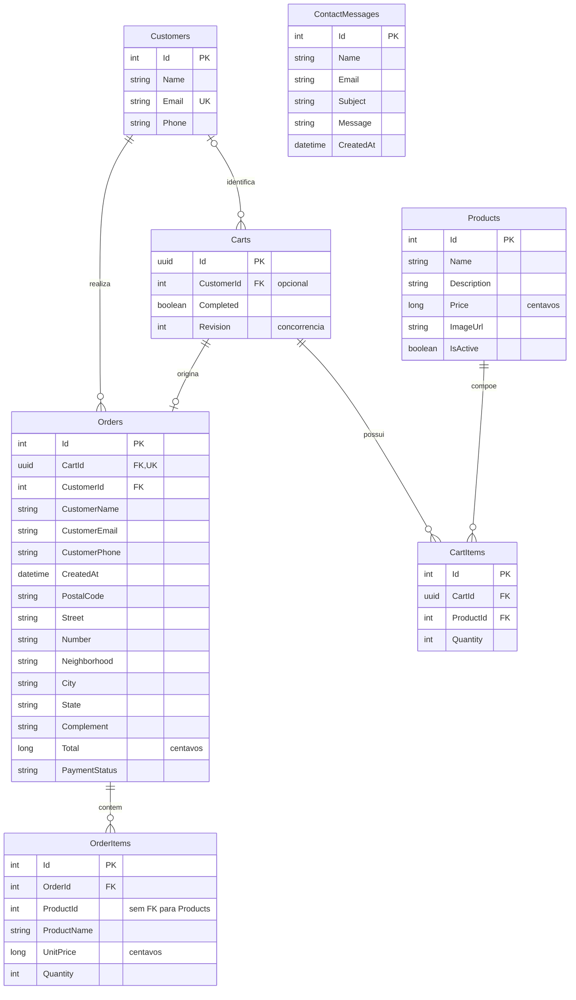

# Estrutura do banco de dados

## Modelo utilizado

A loja utiliza um banco relacional com sete entidades comerciais. O mesmo modelo de negócio é utilizado no SQLite local e no PostgreSQL configurado para produção, com migrations específicas para cada provedor.

O diagrama representa as relações físicas. `ContactMessages` é independente e não exige um cliente cadastrado. `OrderItems.ProductId` guarda o identificador do produto de origem, mas não possui chave estrangeira para `Products` no modelo atual.

A cardinalidade física permite zero ou mais itens. A regra de aplicação exige pelo menos um item para criar um pedido. O carrinho pode existir sem cliente até o checkout, e cada carrinho pode originar no máximo um pedido.

## Dicionário de dados

| Tabela | Campos e finalidade |
| --- | --- |
| `Products` | `Id` identifica o produto; `Name`, `Description` e `ImageUrl` apresentam o cupcake; `Price` contém o preço; `IsActive` controla sua presença na vitrine |
| `Customers` | `Id` identifica o cliente; `Name`, `Email` e `Phone` contêm seus dados de identificação e contato |
| `Carts` | `Id` é UUID; `CustomerId` é opcional; `Completed` indica finalização e `Revision` controla concorrência otimista |
| `CartItems` | `Id`, `CartId`, `ProductId` e `Quantity` representam a escolha de um produto e sua quantidade |
| `Orders` | `Id`, `CartId` e `CustomerId` identificam a compra e seus vínculos; `CustomerName`, `CustomerEmail` e `CustomerPhone` preservam o cadastro da compra; `CreatedAt`, `Total` e `PaymentStatus` registram o resultado |
| `Orders` | `PostalCode`, `Street`, `Number`, `Neighborhood`, `City`, `State` e `Complement` armazenam a entrega diretamente no pedido |
| `OrderItems` | `Id`, `OrderId` e `ProductId` identificam o item e sua origem; `ProductName`, `UnitPrice` e `Quantity` preservam a composição da compra |
| `ContactMessages` | `Id` é o protocolo; `Name`, `Email`, `Subject` e `Message` registram o contato; `CreatedAt` registra a data de recebimento |

Não há tabelas separadas para endereço, pagamento, sessão, estoque ou avaliações. O endereço faz parte de `Orders`, o resultado do pagamento é um texto nesse registro, e os depoimentos são definidos no código do front-end.

## Tipos e representação

| Informação | Domínio C# | SQLite | PostgreSQL |
| --- | --- | --- | --- |
| Identificador numérico | `int` | `INTEGER` com geração automática | `integer` com identidade |
| Identificador do carrinho | `Guid` | `TEXT` | `uuid` |
| Preço e total | `decimal` | `INTEGER` em centavos | `bigint` em centavos |
| Indicador lógico | `bool` | `INTEGER` | `boolean` |
| Data de pedido e contato | `DateTime` UTC | `TEXT` com conversão para UTC na leitura | `timestamp with time zone` |
| Textos comerciais | `string` | `TEXT` | `text`, ou `character varying` nos campos de contato com tamanho configurado |

Os valores monetários são multiplicados por cem ao gravar e divididos por cem ao ler. Essa conversão preserva duas casas decimais sem depender de ponto flutuante. As datas são criadas em UTC e a interface apresenta a data conforme o navegador.

## Índices e integridade

| Restrição | Finalidade |
| --- | --- |
| Índice único em `Customers.Email` | Evitar cadastros de cliente com o mesmo e-mail normalizado |
| Índice único em `CartItems.CartId` e `ProductId` | Manter uma linha por produto em cada carrinho |
| Índice único em `Orders.CartId` | Impedir mais de um pedido por carrinho |
| Chaves estrangeiras dos itens | Relacionar itens ao carrinho ou pedido correspondente |
| Restrição de exclusão entre `Orders` e `Carts` | Impedir apagar um carrinho referenciado por pedido |
| Token `Carts.Revision` | Detectar atualizações concorrentes no EF Core |

Regras como a quantidade máxima, os formatos dos campos e os limites de preço são verificadas pela aplicação. Não devem ser descritas como restrições `CHECK` do banco, pois essas constraints não foram criadas nas migrations.

## Preservação do histórico

A remoção de produto é lógica e mantém a linha no banco. Além disso, `OrderItem` copia nome e preço no momento da compra. O pedido também copia os dados do cliente, evitando que uma edição posterior altere a identificação registrada naquela compra.

Uma recusa de pagamento não cria registro de pedido ou pagamento recusado. O carrinho permanece aberto. O endereço daquela tentativa também não é salvo como cadastro independente.

## Migrations e elementos legados

O SQLite mantém as migrations `InitialSqlite`, `GourmetShop` e `ContactMessages`. O PostgreSQL possui `InitialPostgres`, que cria o esquema compatível com esse provedor. Os arquivos estão em [Data/Migrations](../backend/ChallengeUva.Infrastructure/Data/Migrations).

O contexto ainda mapeia `Hero`, `Superpower` e `HeroSuperpower`, correspondentes às tabelas `Herois`, `Superpoderes` e `HeroisSuperpoderes`. Essas tabelas fazem parte do esquema preservado, mas não são utilizadas pelos serviços ou endpoints da loja. Não foram incluídas no diagrama comercial para não confundir o domínio atual.

A inicialização aplica as migrations do provedor selecionado. Em uma base sem produtos, são inseridos quatro sabores demonstrativos. Não há sincronização automática de dados entre o arquivo SQLite e o PostgreSQL.

## Fontes

- [Entidades comerciais](../backend/ChallengeUva.Domain/Entities/Shop.cs)
- [Mensagem de contato](../backend/ChallengeUva.Domain/Entities/ContactMessage.cs)
- [Mapeamento do contexto](../backend/ChallengeUva.Infrastructure/Data/Contexts/ChallengeUvaContext.cs)
- [Migration PostgreSQL](../backend/ChallengeUva.Infrastructure/Data/Migrations/PostgreSQL/20261117172821_InitialPostgres.cs)
