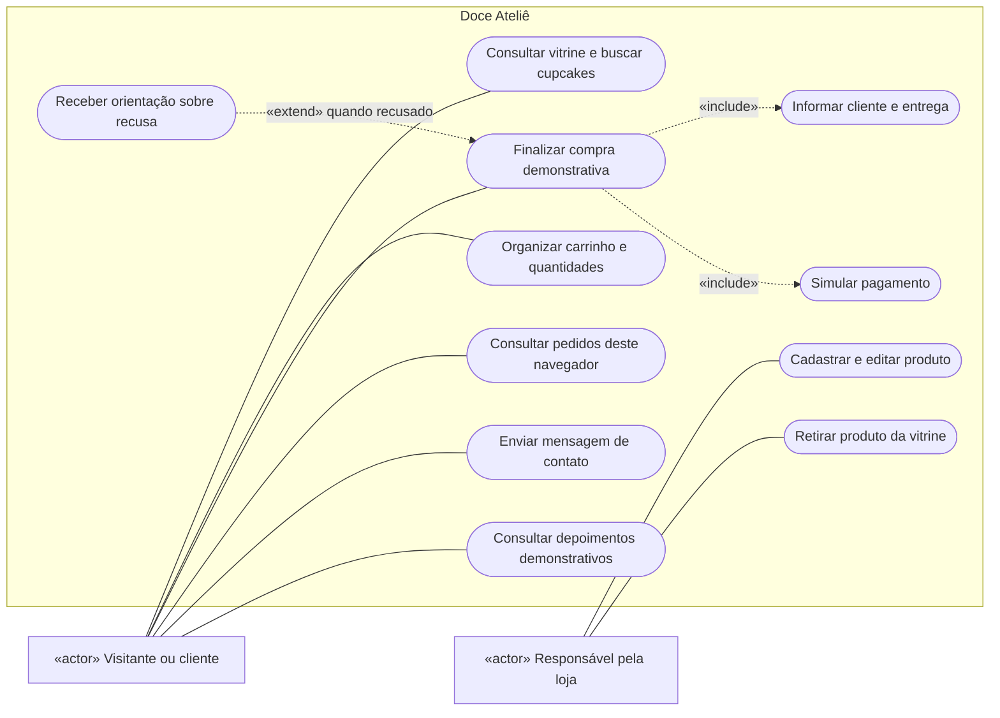
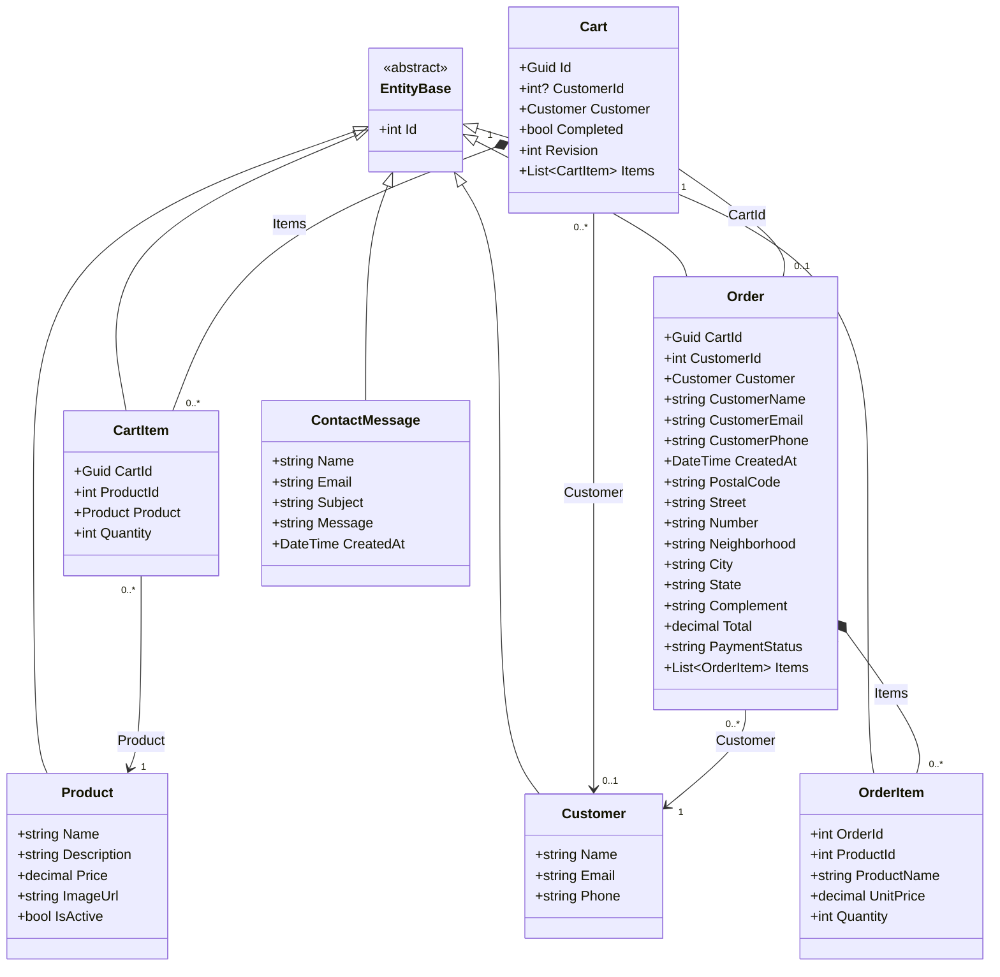
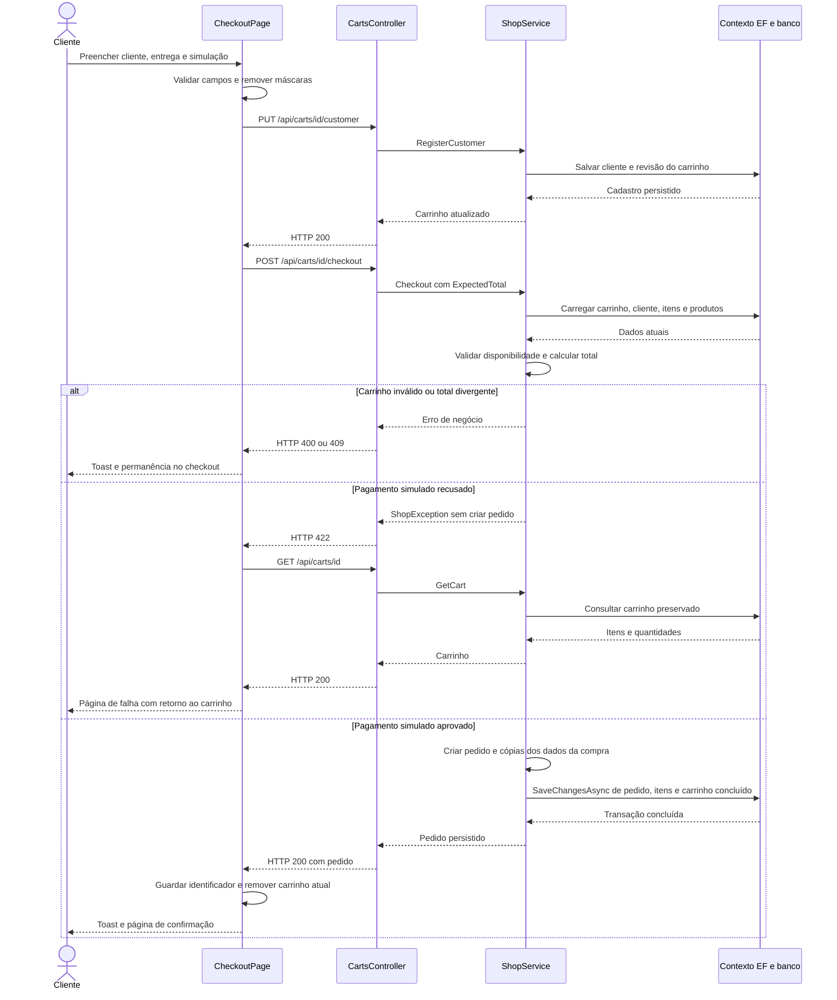
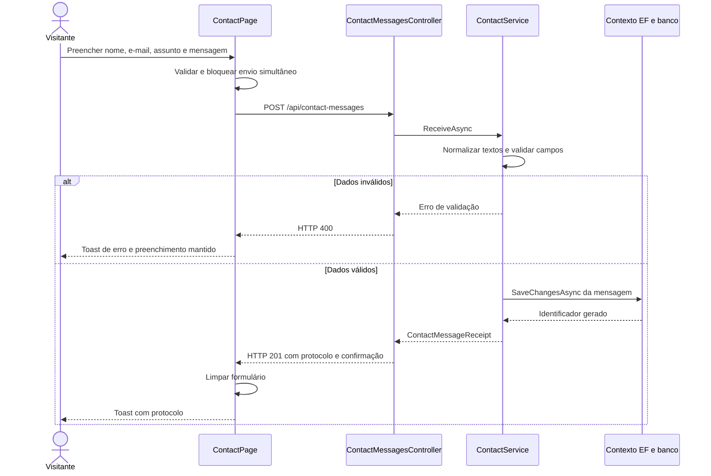

# Modelagem UML

Os diagramas representam o sistema atual, com foco nas funcionalidades comerciais. Não incluem login, gateway externo, estoque ou rastreamento, pois essas funcionalidades não existem no código.

## Casos de uso

Mermaid não possui sintaxe nativa de casos de uso UML. A representação abaixo adapta os atores, a fronteira do sistema, os casos e as relações de inclusão e extensão para um flowchart visualizável no GitHub. As formas arredondadas representam os casos de uso. A relação `include` indica uma parte necessária da finalização, enquanto `extend` representa a orientação exibida na condição de recusa.

Responsável pela loja é um papel de negócio, não um perfil autenticado. A interface e os endpoints de gerenciamento não têm controle de acesso administrativo. O sistema de pagamento não aparece como ator externo porque a simulação é feita pelo próprio serviço da loja.

## Classes do domínio

O diagrama mostra as entidades efetivamente utilizadas pela loja e seus atributos. As operações de negócio ficam em `ShopService` e `ContactService`, em vez de métodos nas entidades. `EntityBase` fornece a chave numérica às classes derivadas; `Cart` possui seu próprio UUID.

`OrderItem.ProductId` é um identificador histórico sem associação configurada como chave estrangeira para `Product`. O nome e o preço são copiados para o item. Também não existem classes independentes de endereço ou pagamento no domínio. Esses dados fazem parte de `Order`.

O modelo relacional completo das entidades comerciais, com chaves e tipos de armazenamento, está em [Banco de dados](06-banco-de-dados.md).

## Sequência de finalização da compra

O fluxo começa com um carrinho aberto e um formulário preenchido. O cadastro do cliente é uma requisição anterior à finalização. Por isso, uma recusa pode manter o cliente salvo, mesmo sem gerar pedido.

O diagrama apresenta as decisões principais. A atualização do carrinho também é tentada após outros erros do checkout. Uma nova chamada válida diretamente ao endpoint de finalização de um carrinho concluído recupera o pedido existente, sem criar uma segunda compra.

## Sequência de envio de contato

Os controllers também podem rejeitar uma entrada inválida antes da chamada ao serviço. Em falhas de comunicação ou persistência, o formulário mantém o conteúdo para nova tentativa. Não há etapa de envio de e-mail ou consulta pública do protocolo.
